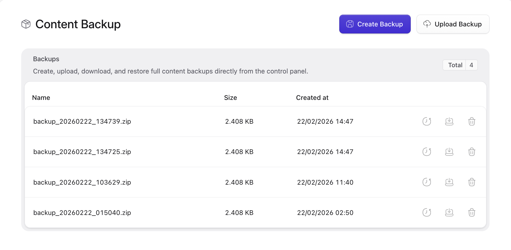

# Statamic Content Backup

 

Statamic Content Backup is a Statamic addon that allows control panel users to create, download, upload and restore content backups easily.



## Features

- Create and restore content backups from the control panel
- Back up files, folders and database tables
- Upload and download backups of any size (uploads are sent in chunks)
- Backups and restores run in the background via Laravel queues
- Failed restores put your files back as they were

## Requirements

- PHP `zip` extension
- A queue worker (see [Queue](#queue))
- To back up database tables, the database command line tools on the server: `mysqldump` and `mysql`, `pg_dump` and `psql`, or `sqlite3`

## Installation

Install this addon running the following command from your project's root directory:

```bash
composer require lucapon/statamic-content-backup
```

After installation, publish the configuration file with:

```bash
php artisan vendor:publish --tag=statamic-content-backup-config
```

### Queue

Backups are created and restored by queued jobs. Make sure `QUEUE_CONNECTION` is not set to `sync` (the default in Statamic's `.env`), otherwise they run inside the HTTP request and large backups may hit your web server timeouts. Then run a queue worker, in production with a process monitor such as Supervisor:

```bash
php artisan queue:work
```

Jobs can run for up to 20 minutes, so set the `retry_after` value of your queue connection in `config/queue.php` higher than that (e.g. `1260`).

## Usage

Once installed, the addon is available under **Utilities > Content Backup** in the Statamic control panel.

Access is granted with the `access content_backup utility` permission, under **Users > Roles > Utilities**. Only give it to trusted users: restoring a backup overwrites every file and table in your configuration, so whoever can upload and restore backups can change any content, and any user account if the users folder is included.

## Configuration

The configuration file is located at `config/statamic-content-backup.php`:

- `include_files`: files and folders to back up, relative to the project root
- `include_tables`: database tables to back up
- `backup_folder`: where backups are stored
- `backup_filename_format`: name of the created backups, with the `{date}`, `{time}` and `{appName}` placeholders
- `upload_chunk_size`: size of the upload chunks (see [Uploading large backups](#uploading-large-backups))

### Restoring a backup

Restoring a backup brings the configured files and folders back exactly as they were when the backup was created, so files added since then are removed. Paths added to or removed from `include_files` after the backup was created are left untouched.

The configured database tables are replaced with the ones in the backup. With PostgreSQL, a table can't be restored while other tables have foreign keys pointing to it.

If a restore fails, files and folders are put back as they were. Database tables are not rolled back: the ones restored before the error keep the backup data, and the one that failed may be left incomplete.

Only one backup or restore can run at a time.

### Uploading large backups

Backups are uploaded in chunks, so their size is not limited by PHP or the web server. Each chunk is 1 MB by default and must stay below `upload_max_filesize`, `post_max_size` and the web server body limit (e.g. nginx `client_max_body_size`). You can change it with the `upload_chunk_size` option.

Interrupted uploads older than 24 hours are deleted automatically when a new upload starts.

## Upgrading

### Upgrading to v3

If you upgrade to version `^2.0.0` or `^3.0.0`, it is recommended to republish the configuration file to ensure compatibility with the updated features. Run the following command:

```bash
php artisan vendor:publish --tag=statamic-content-backup-config --force
```

This will overwrite your old configuration file with the updated version. Be sure to review the new configuration file for any additional options or changes.

### Upgrading to v4

Version `4.x` requires **Statamic 6** (and Laravel 12 or 13). It is not compatible with earlier versions of Statamic.

```bash
composer require lucapon/statamic-content-backup:^4.0
```

**Permissions:** In v3, the addon used a custom permission (`statamic-content-backup-permission`). In v4, permissions are managed automatically by Statamic's utility system. The permission is now `access content_backup utility` and can be configured under **Users > Roles > Utilities** in the control panel.

### Upgrading from v4.0

- Restores now run in a queued job too: check the [Queue](#queue) settings, including `retry_after`.
- If you back up database tables, the `mysql`, `psql` or `sqlite3` client must be installed on the server, besides the dump tool.
- Restart your queue workers after updating (`php artisan queue:restart`), otherwise they keep running the old code.
- The `storage/app/chunks` folder used by the old uploader is no longer needed and can be deleted.
- Optionally, add the new `upload_chunk_size` option to your configuration file.

## Testing

```bash
composer install
composer test
```

The tests use SQLite by default and need the `sqlite3` client. To run them against another database, set the `DB_*` environment variables:

```bash
DB_CONNECTION=mysql DB_HOST=127.0.0.1 DB_DATABASE=testing DB_USERNAME=root DB_PASSWORD= composer test
```
